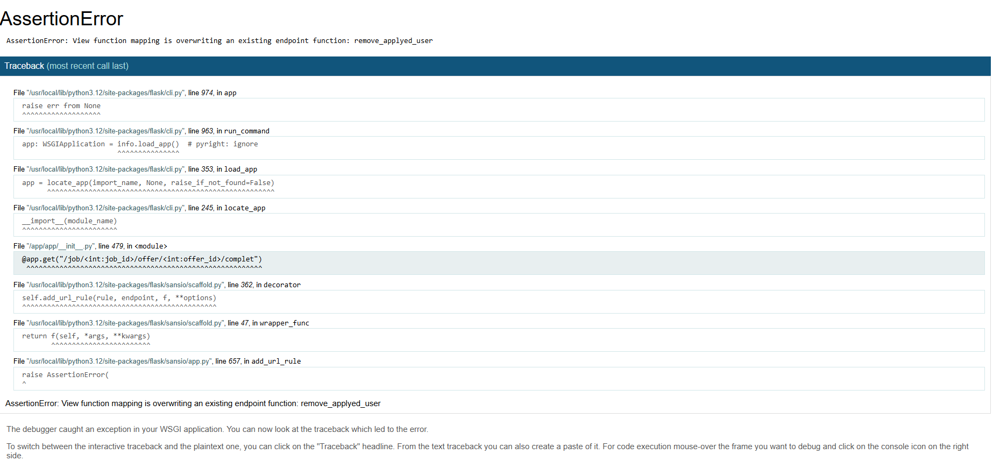
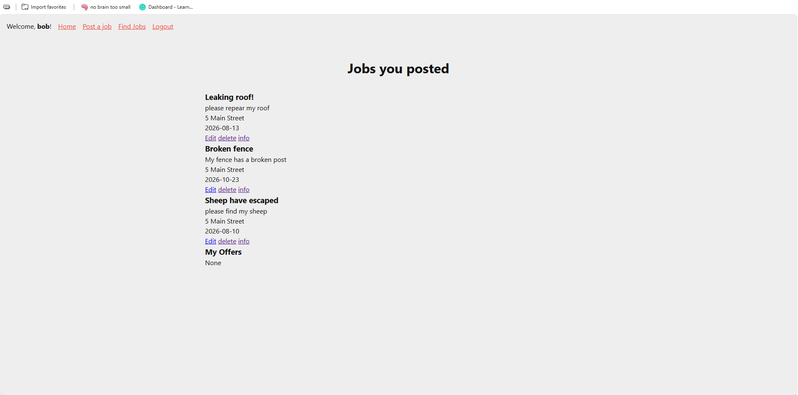
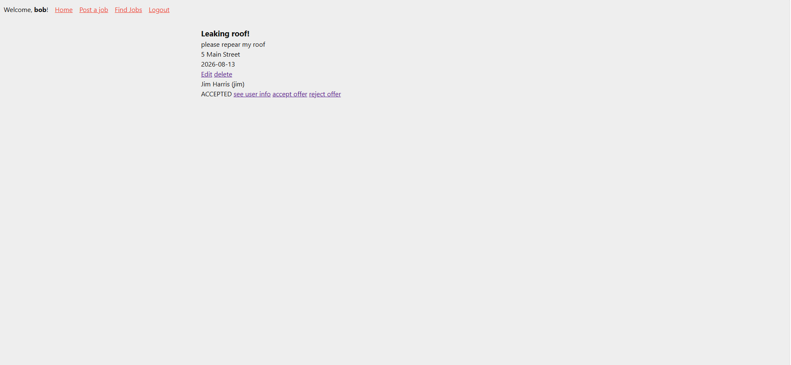

# Sprint 3 - Developing a Minimum Viable Product (MVP)

## Sprint Goals

Continue to develop the web application to the point that it provides all key functionality of the system. Test and refine it so that it can serve as the basis for the final phase of development.

### Specific Goals

**Edit these goals as needed**

- Create the following web pages:
    - Form for wsinging up and login & creating and applying for jobs & 
    - Etc.
- Develop SQL database queries to:
    - Add a new ...
    - Etc.

##  removing users from offered job

so here im testing if i can remove users that has offered to do a job not delete that user from the db but the job offer insted 

<video src="screenshots/20261018-2314-13.1056762.mp4" controls title="Title"></video>

### Changes / Improvements

so as we can see here we where able to delete the offer that user gave us we can also accpted users too 

as you can see here we can't really unaccpted users but you can still remove the offer after it was accpted still which should work insted of unaccpted 

### see job done 

im seeing if the job can only be marked as done when a user has been accpted as a user but we are going start off small with just haveing the button apear 

so this happened because i forgut to change the name of the def 

### Changes / Improvements

ok the page works but theirs no buttons apearing

## change of planes

ive been enlighten that all the complutated stuff like buttons should only be showned once you've click into a job rather than displayed along a list with many jobs so im testing 
how well i can make this fix 

### Changes / Improvements

so it wasn't bad and i got it to work but we are also going finsh the job on this page too 

**PLACE SCREENSHOTS AND/OR ANIMATED GIFS OF THE IMPROVED SYSTEM HERE**

## faving jobs finshes and give other users ratting

## Sprint Review

Replace this text with a statement about how the sprint has moved the project forward - key success point, any things that didn't go so well, etc.
