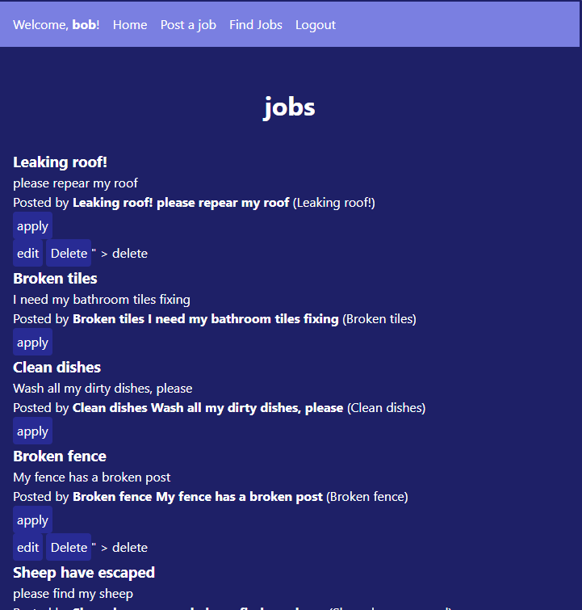

# Sprint 4 - Developing a Refined and Complete System

## Sprint Goals

Develop the system until it is fully featured, with a refined UI and it satisfies the requirements. The system will be fully tested at this point.

### Specific Goals

**Edit these goals as needed**

- Refine the design and UI of the website
- Refine the user experience (UX) of the system
- Perform final, full-system testing

## Testing FEATURE NAME HERE

the buttons are weard and more like links so lets fix that 
i did a little bit before taking a screan shot but this is stil not finshed 

**PLACE SCREENSHOTS AND/OR ANIMATED GIFS OF THE TESTING HERE**

](screenshots/9.png)

### Changes / Improvements

so i got a little carred away and did a little more than the buttons but the buttons are good and working on the rest

](screenshots/css1.png)

## Testing background 

background colour needesd to be right so im testing how it looks 

](screenshots/css2.png)

### Changes / Improvements

i don't think it looks bad and nether do my end users 

**PLACE SCREENSHOTS AND/OR ANIMATED GIFS OF THE IMPROVED SYSTEM HERE**

## Testing seach page 

lets see what the search page looks like and if it's good or not 

### Changes / Improvements

some of the css has carred over but not all so let me fix this 

**PLACE SCREENSHOTS AND/OR ANIMATED GIFS OF THE IMPROVED SYSTEM HERE**

## ETC...

## Sprint Review

Replace this text with a statement about how the sprint has moved the project forward - key success point, any things that didn't go so well, etc.

